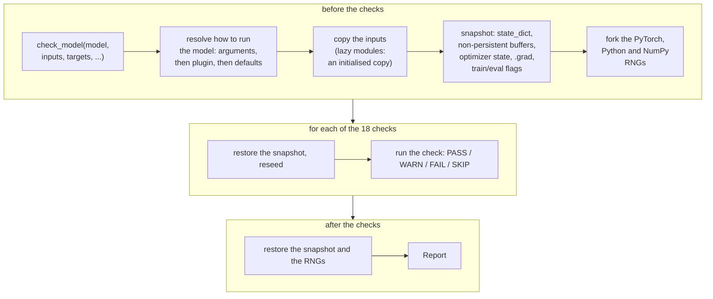
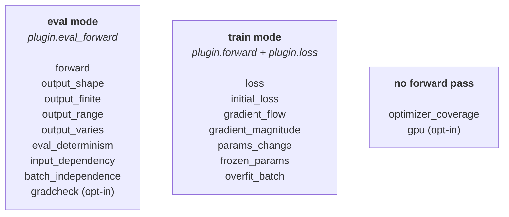
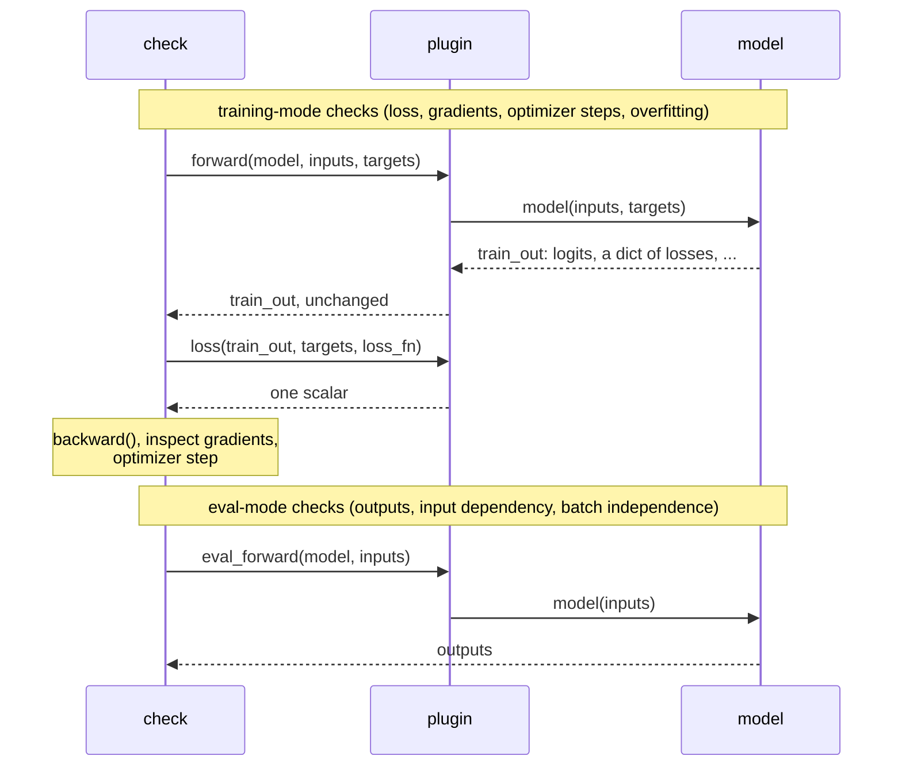

# How torchtest2 works

Three diagrams of the library: what `check_model` does around the checks, which checks run the
model in which mode, and how a plugin plugs into that. Each diagram has one source in
[`diagrams/`](diagrams/) (`*.mmd`); `diagrams/build.sh` renders them to PDF for the tutorial
slides and checks that this page embeds the same sources. GitHub and GitLab render
the diagrams below; elsewhere, see the PDFs next to the sources.

## What `check_model` does around the checks

Before the first check, torchtest2 decides how to run the model, copies the inputs and takes a
snapshot of the PyTorch state; every check starts from that snapshot with freshly seeded random
generators, and at the end everything is restored. This is why a call has no effect on the
model, the optimizer, the random generators or your tensors (see "How it works and limitations"
in the README for exactly what is restored).

## Which checks run the model, and how

Inference checks run the model in eval mode, training checks in train mode; two checks do not run
the model at all. The mode decides which plugin method is used (next diagram).

## How a plugin is used

A plugin does not change what is checked, only how the model is run. For every training-mode
check, torchtest2 calls `plugin.forward(model, inputs, targets)` and hands its return value,
unchanged, to `plugin.loss(train_out, targets, loss_fn)`, which turns it into one scalar. That
value can be logits, but also a dict of losses (detection models, multi-task models) or a model
output object (Hugging Face) - whatever your model returns in training. Eval-mode checks call
`plugin.eval_forward(model, inputs)`. Without a plugin, all three default to calling
`model(inputs)` and using your `loss_fn`.

